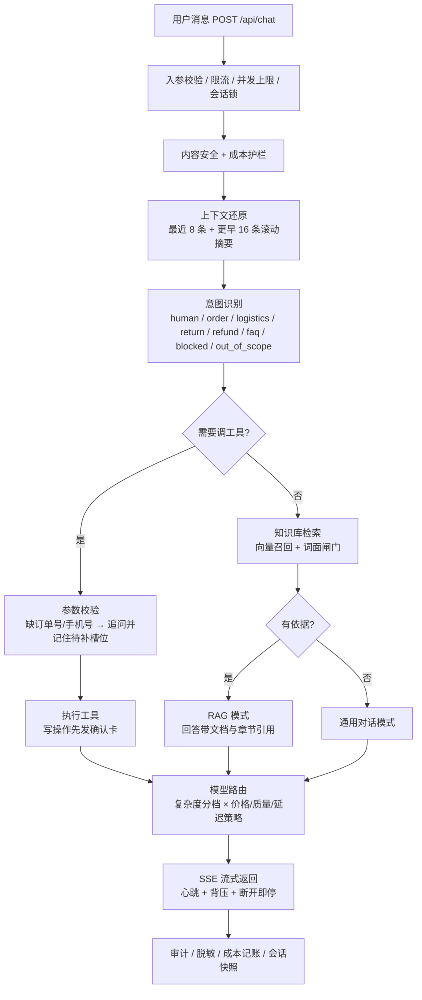

# 智服 Agent · 电商售后智能客服

一个**可安装到手机**的电商售后智能客服 Agent。用户用自然语言咨询/办理售后，系统基于知识库作答、调用业务接口办事，并由**智能模型路由**按"价格/质量/延迟"优先级自动选择底层大模型，兼顾成本与效果。

> 开箱即用：默认使用**离线 Mock 模型**，无需任何 API Key 即可跑通全流程。配置 API Key 后可无缝切换真实模型（DeepSeek / 通义 / Kimi / 智谱）。

---

## 一、核心特性

| 能力 | 说明 |
|---|---|
| 多轮对话 + 真流式 | 适配器逐 token 透传，首字延迟可观测 |
| **三种回答模式** | 自动判断走 **知识库** / **业务办理** / **通用对话**——不相关的问题也正常回答，不机械拒答 |
| **多格式知识库入库** | 真实文档接入：md/txt/html/json/csv/docx/pdf/xlsx/pptx 全解析，结构感知切块，增量更新；页面可直接上传文档并热加载 |
| **外部系统集成** | JSON 声明即可接入 CRM/工单等 HTTP 系统；工具 API 供其他软件反向调用；双向 webhook 带签名 |
| RAG 知识库 | 售后政策检索作答，回答带引用（文档 + 章节），减少幻觉 |
| 工具调用 | 查订单 / 查物流 / 退货 / 退款（写操作二次确认） |
| **智能模型路由** | 按复杂度分档 + 价格/质量/延迟/均衡策略自动选模型；内置 DeepSeek 与通义千问三档 |
| 故障降级 | 主模型失败自动切换备用模型 + 熔断；已吐字后不重试，避免重复输出 |
| 成本控制 | 每次调用记录模型/耗时/首字延迟/费用，后台出成本报表 |
| 转人工兜底 | 说"转人工"即转接 |
| **业务引导跳转** | 查订单/物流/退货后给出按钮，一键进入订单详情、物流轨迹、退货办理页，可直接提交 |
| 移动 App 界面 | React 结构化前端：底部导航 + 四屏幕，切屏不丢对话，PWA 可装机 |
| **容器化** | 后端 + 前端各一个镜像，nginx 反代含 SSE 专用配置，compose 一键起 |
| **测试体系** | 290 项自动化测试：白盒单测 + 黑盒端到端；CI 含评测阈值门禁 |
| **7×24 长稳** | 会话 LRU+TTL 回收、上游超时、SSE 心跳、优雅关闭、客户端断开即停 |
| **高并发保护** | 全局并发上限、单 IP 限流、同会话串行锁；429 带 `FLOW_LIMIT` 原因码与 `Retry-After` |
| **会话持久化** | 变更 2 秒内合并成一次原子快照，重启自动恢复（含待确认动作） |
| **审计日志** | 按天归档 JSONL，记录对话、工具调用、管理操作、鉴权失败，可查询 |
| **成本护栏** | 每日额度：到 80% 自动降级为价格优先，到 100% 拒绝新请求 |
| **可观测** | W3C `traceparent` 透传，结构化 JSON 日志，指标含配额与存储 |
| **合规** | 日志/审计落盘前脱敏手机号、身份证、银行卡、邮箱；输入内容安全前置检查 |

### 三种回答模式如何选择

```
用户消息
  ├─ 明确办理动作（我要退货/帮我退款） → 业务办理（调工具，写操作先确认）
  ├─ 与知识库相关（检索命中 + 词面证据） → 知识库（RAG 检索，带文档与章节引用）
  └─ 闲聊 / 常识 / 越界 / 检索未命中    → 通用对话（正常回答，不硬拒）
```

两种兜底逻辑很重要：

1. **检索不再只服务"售后词表"**。企业上传的文档可能覆盖安装费、开票、价保等词表外的内容，所以除工具动作外都会先检索一次。
2. **无关问题不会被硬套政策**。轻量向量对中文短句区分度有限（"推荐一本书"也能拿到 0.38 相似度），因此对未命中业务词表的问句再加一道**词面闸门**（[lexical.js](server/src/rag/lexical.js)）：查询实字在命中块中的覆盖率需 ≥ 75%，否则视为无关、走通用对话。

模式由 [answerPolicy.js](server/src/agent/answerPolicy.js) 统一决策，与具体模型无关，便于单测与替换。

### 一次请求的完整链路



关键取舍：

- **规则优先、模型兜底**：意图与参数用确定性规则，可单测、可解释、零成本；模型只负责"怎么说"。代价是词表外说法要补规则，评测集因此覆盖了口语化表达。
- **检索必过词面闸门**：轻量向量对中文短句区分度有限，宁可判"无依据"走通用对话，也不把无关政策硬套给用户。
- **写操作双路拦截**：对话入口与 HTTP 工具 API 都会拦未确认的写操作，不依赖前端自觉。
- **索引在进程内**：10 万级切块够用且零外部依赖；再往上应换外部向量库（见"可扩展方向"）。

---

## 二、目录结构

```
客服 Agent/
├─ 需求分析文档.md          # 需求与技术路线
├─ 代码审核报告.md          # 代码审核（4 个 P0 / 5 个 P1 / 6 个 P2）
├─ README.md               # 本文件
├─ docker-compose.yml      # 容器编排（server + web + 数据卷）
├─ .env.example            # compose 用的环境变量样例
├─ .github/workflows/ci.yml # CI：测试 + 评测阈值门禁 + 前端构建
├─ start.ps1               # 本地一键启动（Windows，非容器）
├─ server/                 # 后端（Node.js + Express）
│  ├─ Dockerfile           # 构建期自动执行文档入库
│  ├─ knowledge/           # 示例企业语料（15 篇 / 8 种格式）
│  ├─ data/kb/             # 入库产物：chunks.ndjson + manifest.json
│  ├─ integrations/        # 外部系统连接器配置（crm.json / webhooks.json）
│  ├─ scripts/ingest.js    # 入库命令
│  ├─ test/                # 自动化测试
│  │  ├─ unit/             # 白盒：纯函数与模块
│  │  └─ e2e/              # 黑盒：HTTP + SSE 端到端
│  ├─ bench/
│  │  ├─ loadtest.js       # 压测 / 长稳脚本（吞吐、延迟分位、内存趋势）
│  │  ├─ genCorpus.js      # 生成多格式示例语料
│  │  ├─ kbScale.js        # 知识库规模验证（入库吞吐、内存、检索延迟）
│  │  └─ mockCrm.js        # 假 CRM / 工单系统，验证连接器与 webhook
│  └─ src/
│     ├─ app.js            # Express 应用装配（可被测试直接启动）
│     ├─ index.js          # 启动入口（监听 + 优雅关闭）
│     ├─ config/models.js  # 模型注册表
│     ├─ router/           # 复杂度分类 + 智能模型路由
│     ├─ llm/              # 流式适配器（含上游超时）
│     ├─ rag/              # 检索层：embedding / 向量库 / 知识库 / 词面闸门
│     │  └─ ingest/        # 入库流水线：解析器 + 切块 + 索引持久化
│     ├─ integrations/     # 连接器 / 事件总线 / 签名校验
│     ├─ tools/            # 工具注册表 + 电商工具（内置与外部统一）
│     ├─ guard/            # 成本护栏 + 内容安全前置检查
│     ├─ privacy/          # 敏感信息脱敏（日志/审计落盘前）
│     ├─ agent/            # 编排器 + 回答策略 + 提示词 + 业务引导
│     ├─ middleware/       # 并发上限 / 限流 / 会话串行锁 / 管理鉴权
│     ├─ observability/    # 指标 / W3C trace / 结构化日志 / 审计
│     └─ store/            # 会话 LRU+TTL + 持久化 + 调用日志 + 成本聚合
└─ web/                    # 前端（React + Vite + PWA）
   ├─ Dockerfile           # 多阶段构建 → nginx
   ├─ nginx.conf           # SPA 回退 + /api 反代（含 SSE 关闭缓冲）
   └─ src/
      ├─ App.jsx           # 根：Provider + 顶栏 + 屏幕路由 + 底部导航
      ├─ context/          # 全局状态（会话ID/当前标签/策略/业务页视图）
      ├─ hooks/            # useChat（对话+SSE）/ useAdmin（数据拉取）
      ├─ components/       # BottomNav / chat / knowledge / sessions / admin / biz
      └─ api.js            # SSE / REST 客户端
```

---

## 三、如何运行

### 方式 A：Docker Compose（推荐，环境自带）

```powershell
cd "客服 Agent"
Copy-Item .env.example .env      # 必填 ADMIN_TOKEN；DEEPSEEK_API_KEY 可留空（用离线 Mock）
docker compose up -d --build
```

- 前端：http://localhost:8080
- 后端：http://localhost:4000
- 停止：`docker compose down`
- 日志：`docker compose logs -f`

镜像说明：
- `server`：`node:24-alpine`，`npm ci --omit=dev` 只装生产依赖，带 `/api/health` 健康检查
- `web`：多阶段构建（Node 构建 → nginx 托管），`nginx.conf` 里对 `/api/` 关闭了 `proxy_buffering`，否则 SSE 会被缓冲、前端看不到逐字输出

### 方式 B：本地一键启动（Windows，无需 Docker）
```powershell
cd "客服 Agent"
powershell -ExecutionPolicy Bypass -File .\start.ps1
```
脚本会自动：准备 Node（优先用本机便携版）→ 安装依赖 → 生成图标 → 同时启动后端(4000)和前端(5173)，并打开浏览器。

### 方式 C：手动启动（两个终端）
```powershell
# 终端 1：后端
cd "客服 Agent\server"
npm install
npm start            # http://localhost:4000

# 终端 2：前端
cd "客服 Agent\web"
npm install
npm run icons        # 首次生成 PWA 图标
npm run dev          # http://localhost:5173
```
浏览器打开 http://localhost:5173 。

> 若未全局安装 Node，脚本会自动使用 `C:\Users\ZhuanZ1\nodejs\current` 的便携版；你也可以自行安装 Node 18+。

---

## 四、接入企业知识库（多格式文档）

知识库不是硬编码的几行文本，而是**从真实文件解析出来的索引**。仓库自带一份 15 篇文档的示例语料（`server/knowledge/`），覆盖 8 种格式。

### 4.1 支持的文件格式

| 格式 | 解析方式 | 保留结构 |
|---|---|---|
| `.md` `.txt` `.log` | UTF-8 / GB18030 自动识别 | Markdown 标题层级 |
| `.html` `.htm` | 去脚本样式、实体还原 | `h1-h6` → 标题层级 |
| `.json` `.jsonl` | 记录展开，问答对不拆散 | 问答/标题作为小节名 |
| `.csv` | exceljs 按表格解析 | 工作表 + 表头 |
| `.docx` | mammoth 转 HTML 再提取 | Word 标题样式 |
| `.xlsx` | exceljs | 每个工作表独立小节，每 30 行重复表头 |
| `.pptx` | jszip 拆 OOXML | 按页 + 备注 |
| `.pdf` | pdfjs-dist 按页抽取 | 页码 + 段落还原 |

> 老格式 `.xls`（BIFF）已不再解析：上传时会提示"请用 Excel 另存为 .xlsx 后再上传"。
> 上传文件属于不可信输入，表格解析统一走持续维护的 exceljs，规避 SheetJS 0.18.x 的已知漏洞。

### 4.2 一条命令入库

```powershell
cd "客服 Agent\server"
npm run ingest                       # knowledge/ → data/kb
npm run ingest -- --src D:\docs     # 指定任意目录
npm run ingest:force                 # 忽略增量，全量重建
```

输出示例：

```
扫描文件      : 15
解析入库      : 15
增量复用      : 0
失败          : 0
切块总数      : 105
索引耗时      : 852 ms
按格式统计：
  markdown   文件    5  切块     35
  word       文件    3  切块     16
  pdf        文件    2  切块     14
  ...
```

入库后服务会在 5 秒内自动热加载新索引（见 [knowledge.js](server/src/rag/knowledge.js)），无需重启。

### 4.3 切块策略

不是定长滑动窗口，而是**结构感知切块**（[chunker.js](server/src/rag/ingest/chunker.js)）：

1. 识别 Markdown 标题、`第X章/条`、`1.1`、`【标题】`，生成 `headingPath`
2. 标题与正文一起成块，避免把一条政策拆成两半
3. 单段超长才按句切分，优先在 `。！？；` 断开，绝不硬切
4. 同一标题下相邻块保留 80 字重叠，跨标题不重叠
5. 每个块带 `source / format / headingPath / seq`，回答可溯源到"文档 + 章节"

### 4.4 增量与容错

- `size + mtime` 快速判定，mtime 变了再用 `sha1` 比对内容，避免编辑器另存导致全量重跑
- 未变更文件**直接从旧索引流式拷贝**对应行，不重新解析、不重新向量化
- 全部文件都没变时直接返回，不重写索引（实测 275MB 语料 188ms）
- 单文件解析失败只记录到 `failures`，不影响整批；失败文档保留旧切块，避免临时故障导致知识凭空消失
- 索引先写 `.tmp` 再原子 rename，进程崩溃不会留下半截索引

### 4.5 规模实测

用 `npm run bench:kb -- --docs 2000 --kb 50`（生成 2000 篇、275MB 语料）实测：

| 指标 | 结果 |
|---|---|
| 语料规模 | 275 MB / 2000 篇 |
| 切块数 | 509,255 |
| 全量入库 | 41.5 s（6.6 MB/s，12,270 块/s） |
| GC 后存活内存 | **21 MB**（流式写盘，与语料规模无关） |
| 增量入库（无变更） | 188 ms（全量的 0.5%） |
| 检索（全量扫描） | P50 331 ms |
| 检索（两级：文档质心 → 块） | P50 **18 ms**，Top-1 与全量一致率 96% |

索引体积约为原文的 2.3 倍（含 int8 量化后的向量与重叠文本）。可外推：1 GB 文本约 3.9 分钟入库、索引约 2.3 GB、约 190 万块。

### 4.6 在页面上直接上传文档

知识库页面顶部有「上传知识文档」卡片：点击选择或把文件拖进虚线区域即可，不必再上服务器跑命令。

- 支持格式与 CLI 入库一致：md / txt / html / json / jsonl / csv / docx / pdf / xlsx / xls / pptx，单文件上限 50MB
- 流程：文件落到 `<源目录>/uploads/` → 增量入库（未变更文档复用旧切块）→ 索引原子写 → 立即热加载，无需重启
- 上传成功后立即参与检索：实测上传《上门取件说明》后提问"上门取件怎么预约"，回答直接引用该文档章节
- 同名同内容自动识别为重复，不重复入库；同名不同内容追加 `-1` / `-2` 序号，不覆盖已有文件
- 解析失败（扫描件 PDF、加密文档）会删除该文件并回滚索引，界面直接给出原因，避免每次入库都重复失败
- 上传接口 `POST /api/admin/kb/upload`（原始字节 + `x-file-name` 头），与 `/api/admin/*` 一样受 `ADMIN_TOKEN` 保护

### 4.7 边界说明

- **向量索引目前在进程内存里**，50 万块可用（两级检索 18ms）；到百万级应换 pgvector / Milvus，`VectorStore` 的 `add/search` 接口不变
- 两级检索是**近似**：先按文档质心选 5% 的文档（下限 64、上限 512），再精排。实测 Top-1 一致率 96%，对召回要求极高的场景可设 `KB_HIERARCHICAL=0` 关掉
- PDF 只能抽取**文本层**，扫描件/图片型 PDF 需要先跑 OCR（本仓库未集成）
- 单文件默认上限 50MB（`--max-file-size` 可调），超过直接跳过并在日志里说明
- 图片、音视频不在解析范围内
- 页面上传是**串行入库**：索引是整目录原子重写，并发上传会互相覆盖，所以服务端用队列串行处理

---

## 五、接入外部系统（CRM / 工单 / 任意 HTTP）

Agent 不能只是一个聊天窗口。这里做了三条通道，都已实测跑通：

```
① Agent → 外部系统   把第三方 HTTP 接口声明成工具，对话里直接调用
② 外部系统 → Agent   POST /api/tools/:name，不走对话也能用 Agent 的能力
③ 事件双向           出站 webhook（带签名）+ 入站 webhook（验签后可写回会话）
```

### 5.1 声明式连接器：加一个 JSON 就接入一个系统

配置放在 `server/integrations/*.json`，启动时自动注册成工具（[connectors.js](server/src/integrations/connectors.js)）：

```json
{
  "id": "crm",
  "name": "CRM 客户关系系统",
  "baseUrl": "${CRM_BASE_URL}",
  "auth": { "type": "bearer", "tokenEnv": "CRM_TOKEN" },
  "timeoutMs": 4000,
  "retries": 1,
  "tools": [{
    "name": "crmCreateTicket",
    "desc": "创建售后工单",
    "readonly": false,
    "triggers": ["建工单", "提个工单", "升级工单"],
    "method": "POST",
    "path": "/tickets",
    "params": {
      "phone":   { "in": "body", "required": true, "extract": "1[3-9]\\d{9}" },
      "orderId": { "in": "body", "extract": "SO\\d{6,}" },
      "subject": { "in": "body", "default": "用户申请售后" }
    }
  }]
}
```

要点：

| 能力 | 说明 |
|---|---|
| 环境变量替换 | `baseUrl` / token 支持 `${VAR}`，配置可进仓库、密钥留在环境里 |
| 参数抽取 | 用一条正则从用户原话里取手机号、订单号；取不到就反问，不带着空参数调用 |
| 调用方式 | `in: path / query / body / header` 自动落到正确位置 |
| 鉴权 | Bearer / Basic / 自定义 Header，token 从环境变量读 |
| 超时与重试 | 单次 4s 超时；只对网络错误与 5xx 重试，4xx 不重试 |
| 写操作保护 | `readonly: false` 的工具强制走「确认后执行」，和内置退货/退款同一套流程 |
| 路由 | `triggers` 命中即调用，优先级高于通用意图（"建个工单"不会被订单查询抢走） |
| 失败处理 | 抛错或 5xx 时把错误写回对话，不让用户面对一个转圈 |

### 5.2 工具 API：让其他软件调用 Agent

```powershell
GET  /api/tools                 # 发现能力：名称、参数、是否只读、来源
POST /api/tools/queryOrder      # 只读，直接返回
POST /api/tools/createReturn    # 写操作：未带 confirm 返回 409，带 confirm 才执行
```

```json
POST /api/tools/createReturn
{ "orderId": "SO20260001", "confirm": true }
→ { "tool": "createReturn", "result": { "returnId": "RT12345678", "status": "已受理" } }
```

这样 ERP、工单系统、自动化脚本都能复用同一套业务能力，而不必再造一遍退货逻辑。

### 5.3 事件：双向 webhook

**出站**（Agent → 外部）：`tool.executed`、`tool.failed`、`handoff.requested`、`answer.completed`，带 `x-zhifu-event` 与 `x-zhifu-signature`（HMAC-SHA256），失败重试一次，投递失败会记录在事件列表里。

**入站**（外部 → Agent）：`POST /api/integrations/events`

```powershell
# 未配置 INBOUND_WEBHOOK_SECRET 时不校验；配置后签名错误返回 401
$body = '{"type":"order.delayed","data":{"orderId":"SO20260001","hours":52},"sessionId":"ops-1"}'
# 用 INBOUND_WEBHOOK_SECRET 对原始 body 做 HMAC-SHA256，放到 x-zhifu-signature
```

带 `sessionId` 的事件会写入该会话，用户下次打开就能看到「【系统通知】order.delayed：orderId=SO20260001」。

### 5.4 观测与治理

- `GET /api/integrations` 返回每个连接器的启用状态、工具清单、成功/失败计数、最近错误
- 调用结果统一为 `{ ok, status, data, error, source }`，模型转述与排障用的是同一份数据
- 写操作确认、超时、重试、幂等键（`idempotencyHeader`）都在连接器层统一处理，业务代码不重复实现
- 所有外部调用都会发 `tool.executed` 事件，可被审计系统订阅

### 5.5 本地验证（不用真实 CRM）

```powershell
# 终端 1：假 CRM
cd server && node bench/mockCrm.js

# 终端 2：带连接器启动
$env:CRM_BASE_URL='http://127.0.0.1:4100'; $env:CRM_TOKEN='demo-token'
$env:WEBHOOK_SECRET='demo-secret'; $env:INBOUND_WEBHOOK_SECRET='demo-secret'
node src/index.js
```

对话里说：

- `帮我查一下客户档案 13800001234` → 调 `crmCustomerProfile`，返回「张伟（黄金会员），累计 37 单，历史工单：退货、物流延迟」
- `帮我建个工单，手机号 13800001234，订单 SO20260001` → 弹确认 → 确认后创建 `T-20261027-01`
- 只说 `帮我查一下客户档案` → 反问手机号，不空参调用

### 5.6 边界

- 鉴权只做到**静态 token**，OAuth2 授权码换 token / 刷新还没做
- 连接器配置在启动时加载，改完需重启（知识库索引是热加载的，连接器不是）
- 事件走进程内队列 + 内存环形缓冲，没有 MQ、没有死信队列；进程重启会丢未投递事件
- 没有实现 MCP 协议。当前是 HTTP + JSON 声明式接入，覆盖企业里绝大多数 REST 接口；接 MCP 需要再加一层客户端与工具发现

---

## 六、体验示例

在对话框试试：
- `退货运费谁出？` → 走 RAG 检索，简单问题自动选便宜模型
- `查一下订单 SO20260001` → 调用查订单工具
- `帮我看看 SO20260002 的物流` → 调用物流工具
- `我要退货，订单号 SO20260001` → 触发**二次确认**，点"确认执行"真正办理
- `转人工` → 转人工兜底

**业务引导（一键跳转）**：
- 问「查一下订单 SO20260001」→ 回复下方出现「查看订单详情 →」，点击进入订单详情页（商品/金额/状态/下单时间）
- 问「看看 SO20260001 的物流」→ 出现「查看物流轨迹 →」，进入带时间线的物流页
- 说「我要退货，订单号 SO20260001」→ 确认条上除「确认执行」外还有「去退货办理页 →」，进入填表页可直接提交，返回退货单号

切到「运营」标签：可切换路由策略、查看模型注册表、成本报表、调用日志。

---

## 七、接入真实大模型（已预置 DeepSeek V4.1 Flash）

项目已内置 **DeepSeek V4.1 Flash** 配置，只需填 Key：

```powershell
cd server
Copy-Item .env.example .env
# 编辑 .env，填入：DEEPSEEK_API_KEY=sk-xxxx
```

重启后端即可。模型注册表中该条目的 `enabled` 由环境变量自动判断——**填了 Key 会自动启用并纳入智能路由候选；没填则仍会列出（状态显示"未配置 Key"），但不参与路由**。

一旦配置了任意真实模型的 Key，**三个离线 Mock 模型会自动退出路由**（管理页显示"离线兜底模型"）。原因很实际：Mock 的价格与延迟是写死的数字，均衡策略会永远算出它更划算，结果就是"配了 Key 却从没真正调用过模型"。

| 项 | 值 |
|---|---|
| 模型名 | `deepseek-flash`（代表 DeepSeek-V4.1-Flash-1017） |
| 接口 | `https://api.deepseek.com/v1`（OpenAI 兼容） |
| 上下文 | 1M tokens，支持工具调用与视觉 |
| 私有网关/本地联调 | `DEEPSEEK_BASE_URL` 可覆盖接口地址 |

**没有真实 Key 时怎么验证接入链路**：仓库自带一个 OpenAI 兼容的假服务，能验证鉴权头、请求体、SSE 增量解析、usage 统计、超时与降级（不能验证模型回答质量）。

```powershell
# 终端 1：假 DeepSeek
node bench/mockDeepSeek.js --port 4101 --key demo-key

# 终端 2：指向假服务启动
$env:DEEPSEEK_API_KEY='demo-key'
$env:DEEPSEEK_BASE_URL='http://127.0.0.1:4101/v1'
npm start

# 终端 3：确认真的走了 DeepSeek
curl http://127.0.0.1:4000/api/admin/models
```

### 7.2 阿里云百炼 / 通义千问（DashScope 兼容模式）

同一套 OpenAI 兼容适配器，填 `DASHSCOPE_API_KEY` 即启用三档：

| 模型 | 档位 | 输入/输出（元/1M） | 用途 |
|---|---|---|---|
| `qwen-turbo` | lite | 0.3 / 0.6 | 简单 FAQ、闲聊 |
| `qwen-plus` | standard | 0.8 / 2.0 | 单工具业务办理 |
| `qwen-max` | pro | 2.4 / 9.6 | 复杂纠纷、长上下文 |

```
DASHSCOPE_API_KEY=sk-xxx
# 海外区/私有网关可覆盖
# DASHSCOPE_BASE_URL=https://dashscope-intl.aliyuncs.com/compatible-mode/v1
```

- 接口走 `https://dashscope.aliyuncs.com/compatible-mode/v1/chat/completions`
- 未配 Key 时三档同样以"未配置 Key"出现在管理页，不参与路由
- 质量优先 + 复杂任务时，会落到 `qwen-max`（单测已覆盖）
- 其他厂商（Kimi/智谱）同理，在 `src/config/models.js` 加一条配置即可

> ⚠️ 已知注意点：V4.1 Flash 的 thinking 模式**默认开启**，且 thinking 模式下 `temperature` 不生效。客服场景建议显式关闭 thinking 以降低延迟与成本（详见 [代码审核报告.md](代码审核报告.md#p1-8-deepseek-v41-flash-默认开启-thinking且-temperature-参数静默失效) P1-8）。

---

## 八、关键设计说明（面试可讲）

- **智能模型路由**：先用零成本规则判定任务复杂度（简单/中等/复杂），映射到模型档位，再按当前策略（价格/质量/延迟/均衡）在档位内打分选择；失败自动走 fallback 链并熔断。
- **成本优化逻辑**：简单 FAQ 用轻量模型（约 ¥0.0001/次），复杂办理才用旗舰模型，相比"全量强模型"显著降本（运营面板可见对比）。
- **RAG**：文档切块→向量化→余弦检索 Top-K→拼进提示词；回答带引用。演示用轻量字符 n-gram 向量，生产可无缝替换 bge-m3 / 向量数据库。
- **写操作安全**：退货/退款等写操作必须先向用户复述并确认，才真正执行。
- **可观测**：每轮记录所选模型、耗时、token、成本，支撑成本报表与坏例回溯。

---

## 九、测试体系（白盒 + 黑盒）

```powershell
cd server
npm test          # 91 项，约 1 秒
```

| 层次 | 文件 | 覆盖点 |
|---|---|---|
| **白盒** | `test/unit/intent.test.js` | 意图识别 30 条：正常分类、边界、否定句（"我不要退货了"）、越界注入、空输入 |
| 白盒 | `test/unit/policy.test.js` | 回答策略选择、三种模式提示词构造、复杂度判定 |
| 白盒 | `test/unit/router.test.js` | 模型路由：价格/质量/延迟/均衡策略、成本估算、熔断恢复、全熔断兜底 |
| 白盒 | `test/unit/rag.test.js` | 向量归一化、余弦相似度、检索命中、切块不截断句子 |
| 白盒 | `test/unit/tools.test.js` | 四个业务工具、订单详情、业务引导入口生成 |
| **黑盒** | `test/e2e/api.test.js` | 19 项：健康检查、SSE 对话（三种模式）、写操作二次确认闭环、缺订单号追问、业务接口 200/404/409、管理接口参数校验 |

设计要点：
- 白盒测试针对**纯函数与模块**，不依赖网络，毫秒级完成
- 黑盒测试**只通过 HTTP 观察行为**，在随机端口启动独立实例，不关心内部实现
- `app.js` 与 `index.js` 拆开，正是为了让测试能 `import` 应用而不真的占用 4000 端口

---

## 十、稳定性与高并发（7×24 运行）

### 10.1 长稳设计

| 风险 | 措施 | 位置 |
|---|---|---|
| 会话只增不减 → OOM | 会话 **LRU 上限**（默认 5000）+ **空闲 TTL**（默认 2h）+ 单会话消息上限 200 条 | `store/sessions.js` |
| 调用日志无限增长 | 环形队列，上限 1000 条 | 同上 |
| 上游模型卡死拖垮连接 | 空闲超时 + AbortController 中断 | `llm/openaiAdapter.js` |
| 长连接被网关掐断 | SSE 每 15s 发心跳注释行 + `X-Accel-Buffering: no` | `app.js` |
| 客户端中途离开仍占用资源 | 监听 `req.close`，立即停止生成并释放锁 | `app.js` |
| 滚动更新打断在途请求 | SIGTERM 优雅关闭：停新请求、等在途完成、超时兜底 | `index.js` |
| 单个异步异常打垮进程 | `unhandledRejection` 兜底记录，不退出 | `index.js` |

### 10.2 并发保护

| 保护 | 默认值 | 行为 |
|---|---|---|
| 全局并发上限 `MAX_CONCURRENT` | 64（compose 128） | 超过直接 429 + `Retry-After`，保护事件循环与上游连接 |
| 单 IP 限流 `RATE_LIMIT_PER_MIN` | 600 | 滑动窗口，超限 429 |
| 同会话串行锁 | 自动 | 同一 sessionId 的请求排队，**防止并发"确认"重复执行写操作** |

### 10.3 探针与指标

| 接口 | 用途 |
|---|---|
| `GET /api/health` | 存活探针（liveness）：进程活着就 200 |
| `GET /api/ready` | 就绪探针（readiness）：模型可用 + 知识库已加载，否则 503 |
| `GET /api/admin/metrics` | 运行期指标：RSS/Heap、事件循环延迟 P99、QPS、在途数、P50/P95/P99、限流与超时计数、会话数与淘汰数 |

```powershell
curl http://localhost:4000/api/admin/metrics
```

### 10.4 压测与长稳脚本

```powershell
cd server
npm run bench -- --concurrency 100 --duration 30
npm run bench:soak                      # 50 并发 × 300 秒
node bench/loadtest.js --concurrency 100 --duration 90 --sessions 5000
```

脚本会在运行中每 10 秒打印一次服务端指标，结束时给出吞吐、延迟分位、状态码分布，以及**内存后半段是否仍在上涨**的判定。

### 10.5 实测结果（本机，离线 Mock 模型）

**A. 100 并发 × 90 秒，5000 个会话（触发 LRU）**

| 指标 | 结果 |
|---|---|
| 请求数 | 18,330，**失败 0** |
| 吞吐 | 201.7 req/s |
| 客户端延迟 | P50 589ms / P95 930ms / P99 934ms |
| 最大在途 | 100 |
| 会话数 | 封顶 2000，淘汰 16,331（LRU 生效） |
| 内存 | 启动期一次性增长到 191MB 后**走平**，后半段 +0.0% |
| 事件循环延迟 P99 | 33ms |

**B. 400 并发（故意超过上限 256）**

| 指标 | 结果 |
|---|---|
| 200 成功 / 429 拒绝 | 2,033 / 24,435 |
| 最大在途 | 严格封顶 **256** |
| 内存 | 130MB，后半段 +0.0% |
| 结论 | 超载时**优雅降级**，不雪崩、不 OOM |

### 10.6 生产部署建议

```powershell
docker compose up -d --build
docker compose up -d --scale server=3     # 水平扩容（nginx 已配 DNS 重解析与失败重试）
```

- 容器已配 CPU/内存上限、`stop_grace_period: 20s`、`/api/ready` 健康检查
- 7×24 建议再补：外部监控告警（接 Prometheus/Grafana）、日志轮转、`--max-old-space-size` 约束堆、定期重启策略（如每周滚动）
- **接真实模型后并发要重新标定**：上限应受上游 QPS/并发配额约束，而不是本机 CPU。Mock 模式 200 req/s 不代表真实模型下也能跑这么高

> 说明：本地实测最长 90 秒量级，**不等于已完成 7×24 验证**。真正的长稳需要在目标环境连续跑数天，用 10.3 的指标观察 RSS 与事件循环延迟是否出现缓慢爬升。

### 10.7 接口鉴权

管理类接口能改路由策略、直接执行退货退款、查看调用日志，之前是裸奔的。现在：

```
ADMIN_TOKEN=xxx        # 在 server/.env 设置
```

设置后 `/api/admin/*`、`/api/tools` 需要 `x-admin-token`（或 `Authorization: Bearer`），否则 401。

- 令牌比较用 `crypto.timingSafeEqual`，避免时序侧信道
- 未设置时放行并**只告警一次**，保证本地演示与自动化测试开箱即用
- 入站 webhook `/api/integrations/events` 例外：它用 HMAC 验签，不依赖管理令牌
- 前端在 401 时会弹出令牌输入框，存在 localStorage，后续请求自动带上

仍未覆盖：多用户 / 角色权限 / 操作审计。这些需要接公司 SSO 与审计平台，属于下一阶段。

---

## 十一、评测系统（1 万条 + DeepSeek 评委）

完整的评测设计与结果见 **[server/eval/评测报告_1万条.md](server/eval/评测报告_1万条.md)**。

```powershell
cd server
node eval/generateTestSet.js   # 生成 1 万条用例（6 类，种子固定可复现）
node eval/runEval.js           # 全量跑 Agent + 规则打分（EVAL_FAST 自动开启）
node eval/judgePrompts.js      # 生成 DeepSeek 评委提示词（非业务题抽样）
```

**结果概要**：

| 类别 | 数量 | 通过率 |
|---|---|---|
| faq（政策咨询） | 3,000 | 100% |
| order（查订单） | 1,500 | 100% |
| logistics（查物流） | 1,000 | 100% |
| return（退货·写操作） | 1,000 | 100% |
| refund（退款·写操作） | 500 | 100% |
| nonbusiness（非业务） | 3,000 | 100% |

**非业务题用 DeepSeek 网页版评委打分**（相关性/得体性/边界处理，各 1-5 分）：

| 轮次 | 平均分 | 说明 |
|---|---|---|
| 修复前 | 3.8 / 15 | 非业务问题被硬套退款/退货政策，严重答非所问 |
| 修复后 | 11.4 / 15 | 礼貌说明服务边界并引导，提升 +200% |

> 评测驱动的两轮迭代：首轮发现 5 类问题（非业务硬套政策、切块截断、咨询/办理混淆、物流误路由、转人工误判），修复后 1 万条全通过，并用评委复评验证真实改善。

**路由成本优化（准确率提升的连带收益）**：修正"复杂度按业务敏感词判定"的缺陷后，同一套 1 万条用例的成本从 **¥9.82 降至 ¥2.25（-77%）**，模型分布变为：

| 模型档位 | 占比 | 承接场景 |
|---|---|---|
| 轻量（lite） | 72.3% | 政策咨询、闲聊 |
| 标准（std） | 25.0% | 查订单、查物流 |
| 旗舰（pro） | 2.7% | 投诉纠纷等复杂诉求 |

之前「退货运费谁出？」这种一句话咨询会被判为复杂、走去最贵的旗舰模型；现在按**任务形态**判定，只有真正的投诉/纠纷才用强模型。

---

## 十二、生产化（持久化 / 审计 / 配额 / 可观测）

演示能跑通和生产能用是两件事。这一节是补齐"线上会出事"的部分。

### 12.1 会话持久化

- 变更后 **2 秒防抖**合并成一次快照，`data/sessions.json`，先写 `.tmp` 再原子 rename
- 启动时 `restoreSessions()` 恢复，按 TTL 丢弃过期会话，超上限按最近访问保留
- 优雅关闭（SIGTERM）与超时强杀前都会 flush 一次
- 实测：发一轮对话 → 重启进程 → 启动日志 `会话恢复 1 个`，会话消息与引用完整

边界：单实例设计，**多副本不要共享同一个数据卷**（最后写入为准）。多副本应把 `store/persistence.js` 换成 Redis/数据库，上层接口不变。

### 12.2 审计日志

`data/audit/audit-YYYY-MM-DD.jsonl`，一行一条，只追加不修改：

| 动作 | 触发点 | 记录内容 |
|---|---|---|
| `chat.completed` | 每轮回答结束 | 模式、意图、模型、策略、成本、首字/总耗时、工具列表、检索条数 |
| `tool.call` | 工具 API 调用 | 工具名、只读与否、来源、结果；**只记参数名不记参数值** |
| `admin.strategy` | 改路由策略 | 变更前后取值 |
| `auth.denied` | 管理接口 401 | 来源 IP、路径 |

查询：`GET /api/admin/audit?limit=100&date=2026-10-27`

为什么只记参数名：手机号、订单号属于个人信息，落进审计日志会扩大泄露面；排查问题时用 traceId 关联业务日志即可。

### 12.3 成本护栏

```
DAILY_COST_LIMIT=50        # 每日 50 元，0 表示不限
DAILY_COST_SOFT_RATIO=0.8  # 80% 触发降级
```

- **软阈值**：不拒绝请求，但把该请求的路由策略强制降为 `price`，先保可用性再控成本
- **硬阈值**：SSE 返回明确错误「今日成本额度已用完（已用/上限）」，并写审计 `chat.blocked`
- 计数按 UTC 自然日滚动；多副本各算各的，生产应换 Redis 计数

### 12.4 可观测

- 每个请求自动生成 `x-request-id`（可透传上游），贯穿访问日志、审计、SSE 事件
- 日志默认 JSON 行（`LOG_FORMAT=json`），可直接接 Loki / ELK；`LOG_LEVEL` 控制级别
- `GET /api/admin/metrics` 除内存/事件循环/延迟分位外，增加 `quota`（今日花费、剩余、是否降级）与 `store`（会话数、是否持久化）

### 12.5 配置校验：启动即失败

`config/env.js` 在启动时校验数值范围与必填项，错误直接退出，不带病运行：

- `PORT` / `MAX_CONCURRENT` / `SESSION_TTL_MS` 等超出合理区间 → 拒绝启动
- `NODE_ENV=production` 且未设 `ADMIN_TOKEN` → 拒绝启动
- 弱令牌、缺模型 Key、入站未配验签密钥 → 告警但放行

compose 里用 `${ADMIN_TOKEN:?请在 .env 中设置}` 让编排层先报错，而不是容器起来后反复重启。

### 12.6 部署注意

- 知识索引在镜像的 `/app/kb-index`（构建期生成），运行期数据在 `/app/data`（挂载卷）；两者分开，避免挂载把索引遮住
- `DATA_DIR` 可覆盖数据目录；容器内默认 `/app/data`
- 多副本 + 共享卷会造成会话快照互相覆盖，扩容前先替换存储层

### 12.7 全链路追踪（对齐 W3C Trace Context）

- 上游传 `traceparent` 时直接沿用其 trace-id，并在响应头回写新的 span-id
- 没有上游上下文时生成 32 位十六进制 trace-id
- 响应头同时保留 `x-request-id`，兼容只认这个头的旧系统
- 因此可以直接接阿里云 ARMS / OpenTelemetry Collector / Jaeger，不需要改业务代码

```powershell
curl -H "traceparent: 00-4bf92f3577b34da6a3ce929d0e0e4736-00f067aa0ba902b7-01" http://localhost:4000/api/health -i
# x-request-id: 4bf92f3577b34da6a3ce929d0e0e4736
# traceparent : 00-4bf92f3577b34da6a3ce929d0e0e4736-<新span>-01
```

### 12.8 数据脱敏与内容安全

**脱敏**（[redact.js](server/src/privacy/redact.js)）：日志与审计落盘前自动遮盖手机号、身份证、银行卡、邮箱。

- 会话存储保留原文（多轮对话还要用手机号继续办事），只对**长期保存、多方读取**的日志与审计脱敏
- 审计里的工具参数只记参数名，不记参数值
- 订单号、金额不属于个人信息，不脱敏，便于排查

**内容安全**（[moderation.js](server/src/guard/moderation.js)）：调用模型前先审一次输入。

- 默认不启用任何内置词表（避免误伤售后对话），由 `MODERATION_BLOCKLIST` 显式配置
- 命中即拒绝，返回明确提示并写审计 `chat.blocked / moderation`
- 生产建议换成阿里云内容安全（Green）：把 `checkContent` 改为异步调用即可，接口不变

### 12.9 CI 门禁

`.github/workflows/ci.yml`：每次 push / PR 跑

1. `npm test` — 290 项单元 + 端到端（离线 Mock，不需要任何 Key）
2. `npm run eval:gate` — 1 万条评测 + 阈值门禁：任一分类低于阈值、执行异常、或单条平均成本超过 ¥0.01 都会让流水线失败
3. `npm run build` — 前端构建

这样"准确率悄悄掉 2%"会直接阻断合并，而不是等上线后才发现。

---

## 十三、可扩展方向

- **检索增强**：换 bge-m3 embedding + pgvector / Milvus，用同一套 1 万条用例直接对比召回率
- **混合检索**：向量 + BM25 关键词，加 rerank 重排
- **生产化**：限流重试、敏感信息脱敏、审计日志、坏例回流
- **模型对比**：接真实模型后，用同一套评测对比不同模型的性价比与稳定性
